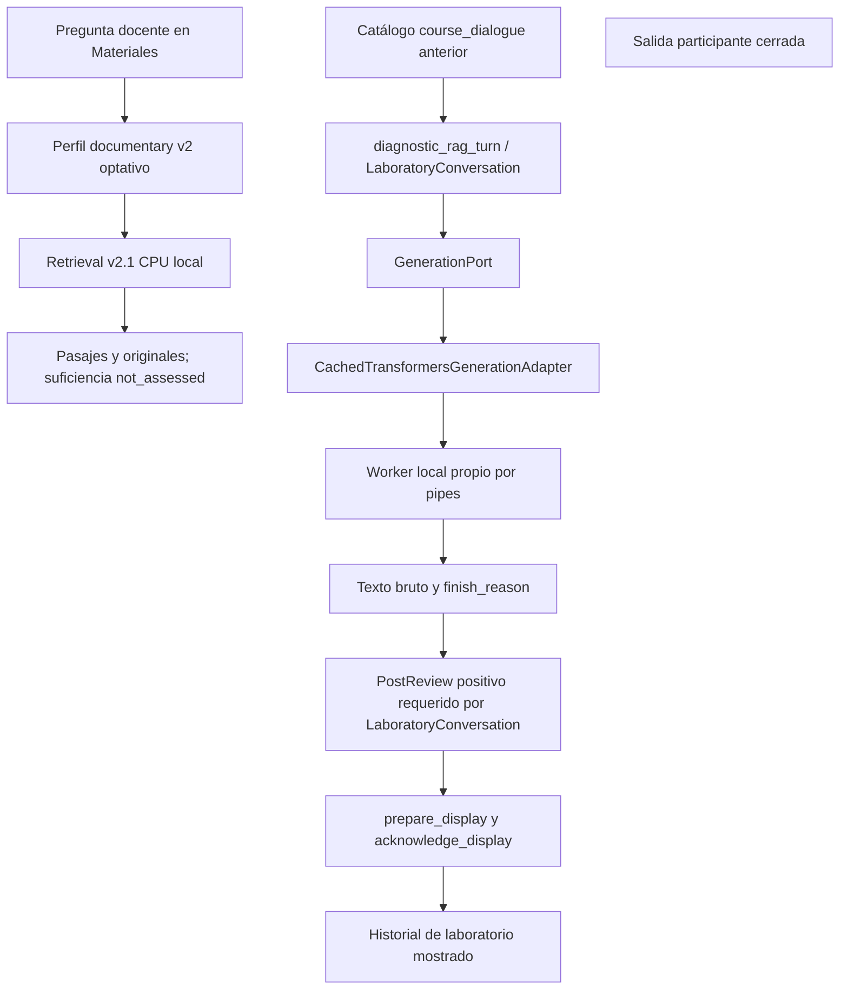

# Primera conversación generativa: E0 verificado; E1 aplazado

27 de octubre de 2026. No hay conversación generada nueva ni demo interactiva acreditada. La comprobación vigente de GPU muestra competencia y el backend rechaza el límite de 60 segundos. Se completó el inventario de E0 y sus pruebas CPU; no se alteró el preview ni se inició inferencia. **0/8 peticiones académicas, 0/1 calentamientos, cero workers/servidores propios iniciados.** E1/E2 quedan pendientes; la feature no está cerrada.

## Configuración y recorrido efectivo

No hay arista efectiva R→G. El endpoint documental `src/oralia/documentary/__main__.py` compone `Retrieval` únicamente con selección v2 + retrieval, y conserva léxico como default. Denso se reserva como candidata experimental explícita del protocolo, sin promoverlo. `runtime.propose` / CLI `course_dialogue` siguen su catálogo/recuperador anteriores; `LaboratoryConversation` emplea `diagnostic_rag_turn`, `retrieve_with_local_expansion` y el binding SQL/política de su catálogo, no el paquete v2. Conectar por parecido de IDs eludiría `assert_catalog`.

Consumidores de `GenerationPort`: `ResponseGeneratorAgent`, `PracticeQuestionAgent`, `FollowupQuestionAgent` y laboratorio local. Defaults participantes Ollama/determinista intactos. El adaptador CUDA existente recibe mensajes, evidencia e historial y devuelve `GenerationOutcome`; el worker valida presupuesto, aplica plantilla local y devuelve texto/terminación/tokens. La propiedad y limpieza de su árbol pertenecen a `OwnedWorkerTree`. Ninguno se ha iniciado aquí.

## Tres superficies y autoridad real

| Superficie | Contrato efectivo y estado |
|---|---|
| Bruto del proveedor | `GenerationOutcome.text/finish_reason`, `last_exchange.raw_worker_response`, recibos del laboratorio. No implica revisión ni permiso de entrega. No hay bruto nuevo en este incremento. |
| Diagnóstico docente | El CLI de inspección ya identifica candidatas no aprobadas; no está acreditado para v2. `LaboratoryConversation` requiere suficiencia y revisión positiva para su preview; `unknown` lo bloquea. Estado de este incremento `unverified`, suficiencia `not_assessed`. No se inyectó ningún evaluador o supported simulado para abrirlo. |
| Participante | `publication_allowed=false`, `participant_display=None`. T090/T150/G2/SC001 siguen cerrados. |

Decisión de E0: no activar una adaptación de vista sin E1/E2 y una frontera revisada. No se cambia el contrato ni se renombra una entrega. Las pruebas con dobles verifican autoridad y transporte, no calidad semántica. El diagnóstico offline futuro necesita autorización local de inspección distinta de publicación, revalidación del paquete antes y después de espera y antes de render, salida inerte, estado persistente unverified y recibo de lo realmente mostrado. Cierre/cancelación/retirada deben invalidar la entrega pendiente. No se afirma que esas garantías estén implementadas para una nueva superficie v2.

En el contrato existente se verifican: revisión unknown/rejected sin preview, retirada durante revisión y antes de acknowledge, preparación sin reconocimiento de visualización, exclusión de candidatas no mostradas del historial y cancelación sin historial. El endpoint documental conserva cookie local/Host/Origin, revalidación después de esperar y rechazo de entrega tras cierre. Esto acredita las rutas existentes, no una conexión generativa nueva ni una sesión desde móvil.

## Preflight real y presupuesto rechazado

Recibos exclusivos: [primera captura](preflight-001/status.json), [GPU primera](preflight-001/gpu.json), [archivos locales](preflight-001/local-files.json), [presupuesto](preflight-001/budget.json), [segunda captura](preflight-002/status.json), [GPU final](preflight-002/gpu.json). Las marcas UTC de los recibos son la referencia; la hora textual interna de nvidia-smi corresponde al host, no a Europe/Madrid. Primera captura 17:06:47 UTC = 18:06:47 en Madrid (CET).

GPU primera: 31.823/32.607 MiB, utilización100 %, potencia129 W. Lectura exploratoria anterior:31.868 MiB/100 %. No se atribuye la carga a un proceso concreto: WDDM no ofrece VRAM por proceso suficiente en esta salida. No se detuvo ComfyUI, documental8022 ni ningún proceso ajeno. La segunda lectura sirve como medición final del preflight, no como permiso de arrancar una inferencia nueva. No hay métricas durante generación porque no hubo generación; no se imputa ningún fallo textual a GPU.

Snapshot esperado Qwen2.5-14B-Instruct `cf98f3b3bbb457ad9e2bb7baf9a0125b6b88caa8`: ocho shards requeridos por el índice presentes, runtime `D:\ai-toolkit\venv\Scripts\python.exe` existente. Se registran tamaños y hashes de JSON/tokenizer/merges. Pesos no hasheados; existencia no acredita carga, compatibilidad efectiva, versión del runtime, plantilla aplicada o cuantización ejecutada. NF4 es configuración solicitada, no observada. Nada se descargó/instaló.

`LabGenerationConstraints` y `gpu_worker.py` limitan a50.000ms; contrato ordinario30.000ms. Laboratorio admite768 tokens; el adaptador conserva presupuesto o rechaza. La solicitud de60.000ms se rechaza explícitamente con ValidationError antes de escribir al worker. **No se negoció ni se adoptó50s, no se amplió el contrato y no hay recorte silencioso.** Este bloqueo es independiente de la GPU. Corrección localizada propuesta para una continuación: ampliar coherentemente solo el contrato lab y validación del worker a60.000ms con pruebas de extremos y timeout exterior; después congelar revisión prospectiva, medir disponibilidad y ejecutar el único modelo autorizado. No está implementada ni se inicia otra candidata.

## Entradas, contexto y contenido

[Protocolo prospectivo](protocol-v1.json): dos secuencias, máximo ocho preguntas y un calentamiento,768 tokens,60s solicitados y20min globales; reglas de dependencia, cambio y ausencia explícitas. Congelado antes de cualquier inferencia, pero no ejecutable por presupuesto rechazado. Solo texto realmente mostrado podrá alimentar el historial de esa superficie; un fallo no crea continuidad ficticia. El historial offline se identificará como experimento, no como sesión humana realizada.

No se han enviado preguntas al modelo ni recuperado contexto para generarlo. Por turno A1–A4/B1–B4: estado `not_run`, sin solicitud efectiva, salida, terminación, tokens, referente mostrado ni revisión contra fuentes. No existen transcriptos/capturas de respuestas nuevas: inventarlos o reutilizar salidas históricas ocultaría que el ensayo no ocurrió. Este informe íntegro es el material disponible desde móvil; no requiere localhost ni abre LAN.

La candidata densa conserva pérdida histórica Q06: tabla22 no entre candidatos; RRF la encontraba pero la perdía al empaquetar. No se repitió ese banco. V2 tiene117 unidades/207 fragmentos; contexto6000 caracteres/5 páginas completas/20 candidatos. Figuras y tablas son limitación aceptada; ausencias de ranking, continuidad entre páginas y empaquetado siguen límites distintos. La mejor media no equivale a promoción general.

## Cambios, comprobaciones y preservación

- Nuevo `scripts/preflight_generated_study.py`: solo inventario/medición, ninguna carga de encoder/generador, listener o autorización de inferencia. Directorio exclusivo y escritura `x`; colisión rechazada sin sobrescribir. Nuevo test CPU de rechazo de60s, conservación del primer recibo y rechazo de directorio existente antes de medir.
- [78 pruebas CPU correctas](tests-second.log): nuevos contratos más laboratory conversation, adapter, output budget, observabilidad, propiedad worker, RAG y recuperación. Fixtures rotulados; no se ejecutan modelos reales. Una advertencia Starlette/httpx preexistente, sin instalar nada.
- [Primer intento](tests-first.log):78 errores de setup, cero pruebas ejecutadas, por padre de basetemp ausente. Creada carpeta propia y segunda ejecución correcta; primer fallo conservado.
- Ruff final sin incidencias y Black final correcto sobre dos archivos nuevos. Black inicial pidió reformatear helper; corregido. Sin modificación web/app: build/navegador no pertinentes para esta entrega CPU; no se acredita E2.
- SpecKit prerequisites localizaron012. Checklists completos: capacity-decision8/8, final-local-candidate9/9, requirements12/12. Sin AGENTS.md en workspace/padres ni extensiones/hooks. Adendas append-only a spec/plan/tasks, copias previas en `before/`, IDs/estados históricos preservados.
- Sin cambios a código de aplicación, corpus, paquetes, índices, originales, SQL, sesiones, presupuestos/reserva históricos; sin commits/Reset/migraciones o servidores propios. La lectura del manifiesto/identidad se registra con hashes en manifiesto final. No se reindexó ni abrió Chroma.

## Estado y cómo comprobar

Implementado: helper CPU, protocolo prospectivo no ejecutable y dossier E0. Verificado:78 contratos/regresiones CPU, presencia de archivos y mediciones GPU. Disponible: evidencia E0 para auditoría. No disponible: conversación v2 generativa nueva ni demo correcta. No probado por usuario, no aceptado para piloto. E1/E2 pendientes por precondiciones; sin inferencia, la calidad/continuidad de la muestra no está medida.

Para repetir únicamente preflight CPU desde raíz: `.venv\Scripts\python.exe scripts\preflight_generated_study.py`. Usa ID nuevo por defecto; no arranca un modelo aunque GPU esté libre. No ofrecer el launcher de autoestudio como demostración de este incremento. La siguiente acción concreta es resolver explícitamente el contrato60s y disponer de GPU, conservando el plan; no empezar otra campaña ni modelo. Se termina este alcance tras el único reporte autorizado al coordinador.

Reporte único enviado correctamente al chat coordinador `01a14951-9510-70d0-85e5-25d51ab1b6ec`, host local, con resultado y rutas del dossier. Sin otros mensajes interchat ni continuación del alcance.
