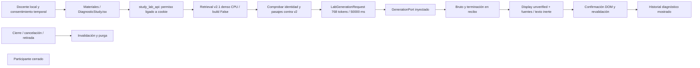

# Cableado diagnóstico v2 implementado y verificado en CPU

27-10-2026. Seguimiento humano «sigamos con cpu». Se implementó el circuito **recuperación v2.1 real → GenerationPort existente → recibo → inspección docente unverified → historial de texto mostrado**, en Materiales. Generador habitual desconectado, fixture opcional rotulado. **Cero inferencias LLM, cero calentamientos y ningún worker/CUDA iniciado.** [Contrato efectivo](../../../specs/012-conversational-course-study/contracts/generated-study-diagnostic-v2.md) · [protocolo50s](protocol-v2-50s.json) · [98 pruebas CPU](tests-transport-final.log) · [captura UI](ui-final.png).

Es una entrega ejecutable de integración CPU, no otro inventario. La conversación generativa real E1 y E2 con contenido real siguen pendientes; no hay aceptación del usuario o apertura participante. El [primer E0](../2026-10-27-first-generated-study/report.md) y su presupuesto rechazado se conservan íntegros.

## Mapa y archivos



- `src/oralia/documentary/study_lab.py`: composición del paquete v2 con puerto existente, presupuesto, tres superficies, control de épocas, contexto, inspección, confirmación, purga y fixture sin contenido académico.
- `study_lab_api.py`: permiso explícito de inspección temporal, cookie/curso/actividad fijos, APIs, lifecycle y lease. No confunde permiso de inspección con supported ni utiliza assert_catalog antiguo con IDs nuevos.
- `src/oralia/documentary/__main__.py`: capacidades/registro optativos, flags `--study-lab` y `--test-provider`, cookie separada y cierre/reentrada. Perfiles anteriores/defaults léxicos conservados. No cambia LaboratoryConversation, GenerationPort, adaptador, worker o sus límites.
- `apps/web/src/components/DiagnosticStudy.tsx` y `routes/Tecnica.tsx`: sección docente identificada dentro de Materiales. Envío/ocupado, UUID y guardia síncrona de doble clic, cancelación/cierre, candidato, bruto técnico separado, fuentes y estado persistente. Texto mediante React/pre; no ejecución de HTML/instrucciones del candidato.
- `tests/unit/test_study_lab.py`: contratos CPU nuevos, fixture de recuperación claramente identificado; usa bytes revisados reales sin afirmar ranking denso donde el ranking es simulado.
- `scripts/verify_study_lab_cpu.py`: comprobación con **ranking denso real**, encoder CPU e índice existente, sin LLM. `scripts/run_prepared_study_trial.py`: runner futuro protegido, preparado pero no ejecutado con su switch de inferencia.

## Autoridad, historial y conservación

Inspección autorizada para el mismo acceso local docente, paquete/fingerprint fijos, curso Ingeniería del Software y actividad diagnóstica de requisitos. No se aceptan curso/actividad/paquete del cuerpo HTTP. Un acceso distinto no consulta recibos ajenos. Se conserva Host/Origin/cookie local, sin LAN. La autorización humana de diagnóstico no acredita alcance semántico ni revisión académica; ambos permanecen no evaluados.

Cada pasaje se contrasta con páginas disponibles del recuperador y documento/hash/página/texto/sección/URL del original. Revalidación antes/después de espera y antes de mostrar/confirmar. No se mezcla el catálogo/binding SQL de LaboratoryConversation, cuyo preview positivo permanece intacto. `unknown` nunca pasa a `supported`; este circuito nunca emite supported. Salida participante siempre null y publicación false.

El proveedor recibe `LabGenerationRequest` con instrucciones congeladas, evidencia real, procedencia,768tokens y50.000ms exactos. La prueba del adaptador existente verifica el frame real serializado en un pipe doble; no ejecuta su worker. Solo candidato completo (`ok/stop`, no vacío,≤4000caracteres) prepara inspección; length/deadline/vacío/exceso no se convierten en respuesta completa ni se recortan. Bruto se inspecciona aparte como diagnóstico.

Historial después de commit del texto exacto al DOM, confirmación y revalidación. Registrar mostrado significa renderizado por la superficie, no leído/comprendido por un humano. Solo últimas tres parejas completas para el generador; recuperación usa últimas dos preguntas confirmadas como referente. Cambio explícito limpia el referente tras mostrar el nuevo turno. Esta resolución limitada puede fallar ante alusiones complejas y no es un clasificador semántico autónomo.

Contenido producto solo en memoria consentida. Cierre, reentrada, retirada y caducidad lo purgan, incluida copia del transporte del adaptador. Heartbeat3s/lease15s/barrido1s reduce retención tras desaparición de pestaña a≤16s con event loop operativo; pagehide/unmount intenta cierre inmediato. La suspensión de la pestaña puede caducar su inspección; suspensión del servidor puede retrasar barrido. No se promete borrado físico seguro. Una fuente retirada invalida entrega inmediatamente al revalidar y retira texto ya visible en siguiente heartbeat de pestaña activa, hasta3s. Las capturas/JSON de este dossier son evidencia sintética autorizada aparte, no una transcripción oculta de uso ordinario.

Cancelación y cierre invalidan épocas y tareas. Aunque un proveedor suprima CancelledError, el host rechaza su entrega tardía; el timeout exterior también revisa plazo después de devolución. Entrada duplicada no invoca otra vez al puerto; otra petición mientras existe tarea o pendiente rechaza. Cierre/purga no reinicia el presupuesto compartido de proceso.

## Evidencia real CPU y UI

[Resumen CPU real](real-cpu-001/summary.json):117 páginas disponibles, fingerprint `c2756d3c78fd3dd9237b5a6aaa5fe63513a38747bf8894635bdb9e44143cf51a`, índice versión2, encoder CPU, cero intentos de conexión externa. Identidad, fragmentos y versión del índice sin cambios, `build=False`; no se reconstruyó Chroma. Dos consultas del demostrador, no repetición del banco30 ni optimización. Recibos UUID únicos en `real-cpu-001/` con consulta, candidatos, pasajes, omisiones, request y bruto **fixture**. La confirmación en ese script es simulada para probar transporte; la evidencia separada de navegador verifica el commit real al DOM. No es una conversación humana o académica generada.

La muestra del navegador recuperó para definición páginas54/6/86/5/87 de Requisitos/Procedimiento, incluyendo definición textual en86. No seleccionadas manualmente por pregunta ni sustituidas por contexto fijo. No se afirma que ese ranking sea suficiente: se conserva lo realmente seleccionado. Todas las páginas y omisiones exactas de las dos consultas están en los recibos; los cambios de selección con referentes quedan observables. No se adjudica calidad académica a los textos de fixture.

Navegador real en servidor propio8027: entrada documental→consentimiento→envío y espera→candidata marcada FIXTURE_CPU_NO_LLM→segundo turno con2 mensajes de historial→aclaración/ejemplo de transporte con4→fuentes legibles→bruto literal. `<script>NO_EJECUTAR</script>` se ve como texto, sin ejecución. [Estado con fuentes completas](ui-sources.txt), [captura](ui-fixture-sources.png), [primera captura](ui-fixture-first.png). No acredita respuesta académica, ejemplo pedagógico o calidad del LLM.

Primer intento de cancelar en UI terminó antes de observar el botón: se conserva como candidata completa, no se llama cancelación exitosa. Se explicitó un retardo2s exclusivo del fixture CLI para hacer observable ocupado/cancelación: [ocupado](ui-busy-second.txt), [cancelado](ui-cancelled.png), [recuperación con0 mensajes](ui-recovery.txt), [reentrada sin candidato previo](ui-reentry.txt). [Versión final](ui-final.txt) incluye aviso de lease y candidata rotulada; [cierre](ui-closed.txt) confirma desmontaje. El usuario no probó el recorrido: lo verificó el implementador. Ninguna navegación desde móvil o LAN se presupone.

## Pruebas, primeros fallos y recursos

- [98 pruebas CPU correctas](tests-transport-final.log) en5,74s: request→adaptador,50s aceptados/60s rechazados, procedencia/contexto, fronteras de retirada antes/durante/después, cambio/ajeno, permiso/consentimiento, acceso entre sesiones, cancelación con proveedor tardío, timeout, truncado/invalidación, duplicado/ocupado, error/recuperación, historial, purga/lease/transporte, perfiles históricos, recuperación/documental. Doubles rotulados, ningún LLM.
- Primeras ejecuciones: atasco de socketpair del event loop Windows bajo sandbox, antes de test; reproducción ampliada confirmó ese punto. Fuera del sandbox apareció fallo real del fixture: faltaba document_id que el recuperador real añade; se corrigió el doble y se limitó su espera por evento a2s para que no oculte fallos. Una ejecución posterior89 correctas/1fallo mostró que FastAPI instalado usa lifespan, no app.add_event_handler; se adaptó a lifespan encadenado. Logs iniciales/segundos/terceros y propiedad de procesos atascados conservados, sin llamarlos aprobados.
- Ruff final sin incidencias y Black correcto sobre seis Python; TypeScript y Vite build final correctos, ESLint dos TSX correcto. Ruff inicial unused/líneas/lambda y Black inicial formato corregidos. Una advertencia preexistente Starlette/httpx; sin instalación para ocultarla.
- El encoder emite advertencia de tokenizer146>128 durante sondas de segmentación: los fragmentos y consultas se comprueban antes de embedding, no se truncó para ocultarla; las dos consultas terminaron. No se atribuye a GPU ni a fallo generativo.
- No se consultó ni usó CUDA/GPU en esta continuación. «Loading weights0/199» del launcher corresponde al encoder MiniLM CPU, no a un LLM. Proceso de prueba propio y recursos CPU/RAM registrados en `server-*-owned.json`, `server-second-resources.json`; no son benchmark. Tres arranques propios sucesivos, sin procesos concurrentes propios de inferencia, detenidos al entregar. No se tocó documental8022, ComfyUI o sesiones ajenas.

## Protocolo y comandos

[protocol-v2-50s.json](protocol-v2-50s.json) conserva ocho escenarios/reglas/criterios,768tokens, una candidata14B NF4, hasta8peticiones+1calentamiento,20min globales y **50.000ms exactos**. Referencia hash del v1 de60s rechazado, preservado sin reinterpretación. No se amplía el backend. El protocolo declara preparado, **sin autorización de ejecutar LLM en esta continuación CPU**.

Para arrancar la superficie habitual con generador desconectado, desde raíz:

```powershell
.venv\Scripts\python.exe -m oralia.documentary --package v2 --retrieval --study-lab --port 8027 --no-browser
```

Abrir `http://127.0.0.1:8027/tecnica?documental=1`. Carga solo encoder CPU/reabre índice. Entrar documental e inspección temporal. Enviar sin proveedor rechaza claramente; no carga LLM, Ollama o fallback. Para comprobar transporte/UI **sin LLM**, añadir `--test-provider`; se identifica persistentemente como fixture. Ctrl+C detiene solo su servidor. El puerto debe estar libre; no reutiliza o detiene un servicio ajeno.

Único paso de medición real preparado para una **futura autorización y disponibilidad GPU**, no ejecutarlo como parte de esta entrega:

```powershell
.venv\Scripts\python.exe scripts\run_prepared_study_trial.py --execute-future-authorized-trial --output docs/audits/2026-10-27-generated-study-cpu/future-real-UNIQUE-ID
```

El runner rechaza por defecto sin switch/output ([prueba del rechazo](future-runner-refusal.log)). Con autorización futura: comprueba snapshot/instrucción del protocolo, carpeta exclusiva y GPU conservadora; recupera CPU, abre `cached_provider` existente14B NF4, worker propio y calentamiento interno1token, captura hasta ocho turnos con dependencias y recibos, consola diagnóstica inerte e historial de lo que imprime,20min globales y muestras antes/durante/después. No usa otro modelo/prompt tras fallo ni repite bancos. Es captura experimental offline, no sesión humana; una demo interactiva con contenido real todavía necesita E2 y revisión de esos resultados. El código de esa vía real está preparado pero **no verificado con un worker real** en CPU; no se presenta como inferencia exitosa.

## Estado y preservación

Implementado: cableado ejecutable, API/UI diagnóstica, aislamiento/retención, protocolos y runners. Verificado:98 pruebas CPU, ranking denso real contra índice acreditado y navegador con fixture. Disponible: pruebas de transporte/inspección CPU y evidencia móvil íntegra. No disponible/acreditado: contenido generativo real revisado, eficacia didáctica, suficiencia/alcance semánticos, E2 real. No probado/aceptado por usuario.

T102 conserva pendiente su captura real; T103 conserva E2 real. Nuevas tareas CPU reflejan solo lo completado. T090/T150/G2/SC001/participante cerrados, T077 global no completado. Corpus/paquetes/originales y protocolos históricos preservados; no Git, SQL, commits/Reset/migraciones/instalaciones/nube/nuevos modelos/reindexación habitual/reserva. El manifiesto final distingue hashes de código/corpus y documentos previos conservados. No cierre de feature, no continuación automática; reporte único autorizado al coordinador y parada del alcance.

Reporte único de este seguimiento enviado correctamente al coordinador `01a14951-9510-70d0-85e5-25d51ab1b6ec`, host local. Los tres servidores propios están detenidos; [estado final](server-final-status.json) confirma cero listeners8027. Sin otros mensajes interchat ni nuevas inferencias.
